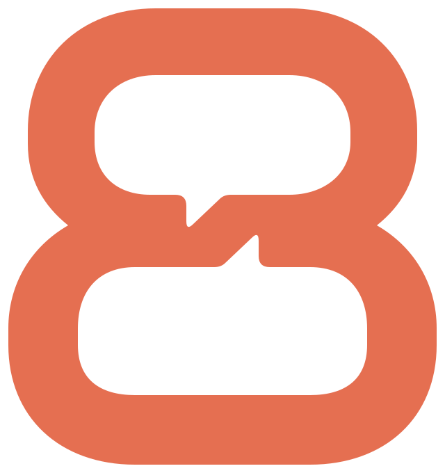
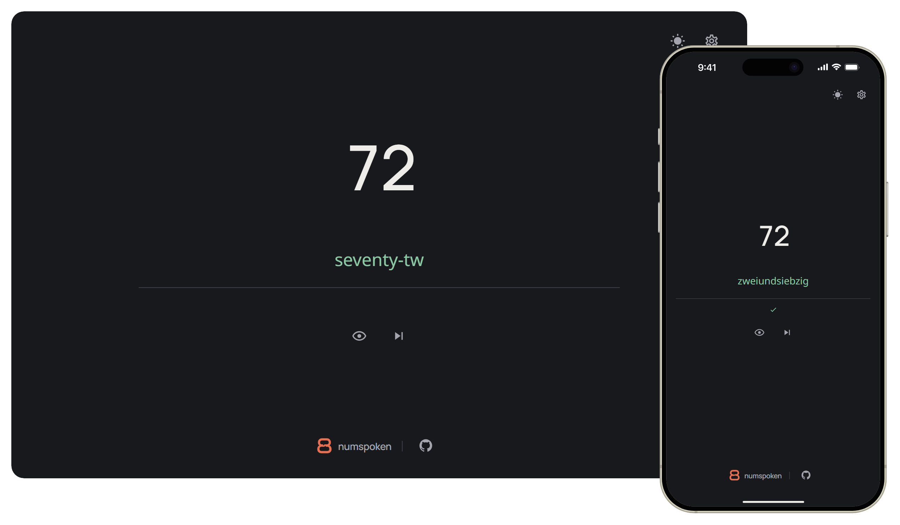

<div align="center">
  
  <h1>numspoken</h1>
  <p>Practise writing numbers in different languages.</p>
  <p>
    <a href="LICENSE.md"></a>
  </p>
</div>



Type the number in words. Correct letters turn green. Choose from 50 languages and 72 variants.

**[Open numspoken](https://ohne-b.github.io/numspoken/)**

## Run locally

Install the Node version in [.nvmrc](.nvmrc), then:

```sh
npm ci
npm run dev
```

Open `http://127.0.0.1:5173/numspoken/`.

## Contributing and hosting

See [CONTRIBUTING.md](CONTRIBUTING.md). To deploy to GitHub Pages, run **Validation**
on `main` with **publish** enabled.

## License and credits

Source available for noncommercial use under [PolyForm Noncommercial 1.0.0](LICENSE.md).
Third-party code and assets retain their original licenses; see [NOTICE.md](NOTICE.md).

Inspired by [learn-numbers](https://github.com/J-Wass/learn-numbers)
and [diminumero](https://github.com/stefanwezel/diminumero).
